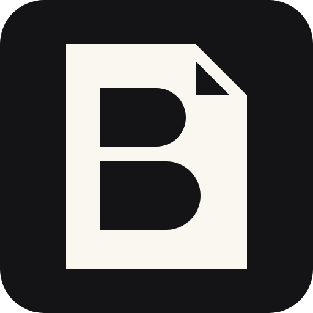

<div align="center">
  
  <h1>BLACKPAGE</h1>
  <p>
    <strong>Hub Media Downloader, Pembaca Komik Multi-Server &amp; Creative Tools</strong><br />
    Dibangun dengan arsitektur <em>Zero-Dependency Node.js</em>, Vanilla ES Modules, dan gaya editorial Bauhaus / Manga.
  </p>
  <p>
    
    
    
  </p>
  <p>
    <a href="https://blackpage-eta.vercel.app/">Live Web App</a> ·
    <a href="./CHANGELOG.md">Changelog</a>
  </p>
</div>

---

## Fitur Utama

### 1. Media Downloader & Antrean Playlist
- **TikTok**: Video No Watermark + MP3 Audio.
- **YouTube**: Video MP4, Audio MP3, dan **Playlist** (lengkap dengan tombol *Download Semua* + batal antrean).
- **Spotify**: Lagu MP3 dan **Playlist** dengan unduhan berurutan.
- **Platform Lain**: Instagram (Reels/Post), Facebook, CapCut, Pinterest, dan **Universal Link Box** di halaman utama.
- **Floating Progress Toast**: Indikator progres unduhan real-time (toast persegi panjang 3 detik lalu mengecil ke lingkaran kiri bawah dengan cincin progres SVG).
- **Galeri Lokal**: Riwayat unduhan dengan filter `ALL` / `VIDEO` / `MP3`, pemutar media bawaan, dan salin caption.

### 2. Baca Komik Multi-Server
- Mendukung **Auto (Semua Server)** serta pemilihan server manual (`Komikindo`, `Bacakomik`, `Kiryuu`, `Komiku`, `Manhwaindo`, `Komikcast`, dan `MangaDex`).
- Pencarian judul komik, halaman update terbaru, paginasi **20 komik**, dan **search chapter** + paginasi **20 chapter**.
- **Auto Scroll** (`Pelan`, `Sedang`, `Cepat`, `Kilat`) berbasis `requestAnimationFrame` dengan kontrol mengambang di pojok kiri bawah serta tombol **Kembali** otomatis saat scroll.

### 3. Creative & Utility Tools
- **Brat Sticker**, **WMP Quote**, **Nokia Retro SMS**, dan **IQC iPhone Quote** — lengkap dengan **Lightbox Gallery View** saat gambar diklik.
- **Text to Speech (TTS Suara)** — konversi teks ke audio MP3 (`ID`, `EN`, `JA`, `KO`, `AR`).

### 4. Pengalaman Android-First
- **Mode Terang & Gelap (Dark Manga)**: Otomatis mengikuti tema sistem Android atau pilih manual, tersinkronisasi dengan bar sistem Android.
- **Penyimpanan Native APK**: Unduhan tersimpan langsung ke `Download/Blackpage/{video,audio,image}` melalui Capacitor `Filesystem`.
- **Double-Back to Exit**: Konfirmasi *"Tekan sekali lagi untuk keluar"* saat menekan tombol Back di halaman utama.

---

## Menjalankan Secara Lokal

```bash
# 1. Jalankan server (Node.js >= 18, tanpa npm install tambahan)
npm start

# 2. Buka di browser
# http://localhost:3000
```

Menjalankan unit test:

```bash
npm test
```

## Build Android APK

Proyek ini sudah terkonfigurasi dengan **GitHub Actions** ([`.github/workflows/build-apk.yml`](.github/workflows/build-apk.yml)) menggunakan **Capacitor 6** untuk membangun `Blackpage-debug-apk` secara otomatis setiap kali ada push ke branch `main`.

---

## Keamanan & Privasi

- **Zero External Runtime Dependencies**: Backend berjalan murni di atas modul bawaan Node.js (`http`, `https`, `crypto`, `fs`, `path`).
- **SSRF Protection**: Endpoint proxy `/api/media` memvalidasi protokol `http/https` dan memblokir alamat lokal/privat (`localhost`, `127.0.0.1`, `0.0.0.0`, `10.x`, `172.16-31.x`, `192.168.x`, `169.254.x`, `::1`, `fe80:`, `fc00:`, `*.local`, `*.internal`).
- **Tanpa Database / Tracking**: Riwayat galeri dan preferensi disimpan secara lokal di perangkat pengguna (`localStorage`).
